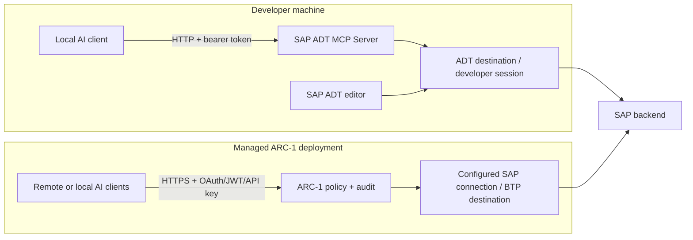

# ARC-1 vs. the SAP ABAP MCP Server — Decision Guide

**Updated 18 October 2026.** Compare ARC-1 with SAP's official ABAP MCP Server and the
surrounding ABAP Development Tools (ADT) experience. The main choice is **where the agent works,
whose SAP identity it uses, and who controls its access**.

**Choose SAP's server for development integrated with ADT. Choose ARC-1 for an independently
hosted, centrally governed MCP service. Use both when you need both workflows.** Source access,
object search, editing and runtime feeds are now documented SAP MCP capabilities; they are no
longer defensible blanket differentiators for ARC-1.

!!! info "Versions and evidence"
    - **SAP:** current SAP Help, the official Marketplace listing, and the installed
      **ADT for VS Code 1.2.0** package were checked for this update. The documented catalog is
      not a successful live test of every tool. Backend release, installed server, configuration
      and entitlement determine availability. VS Code findings are not automatically Eclipse findings.
    - **ARC-1:** the released baseline is **[1.6.0](https://github.com/arc-mcp/arc-1/releases/tag/v1.6.0)**,
      published 17 October. Later merged work and open proposals are identified separately below;
      a `package.json` still saying 1.6.0 on `main` does not put later commits in that release.
    - Existing research, live-test records and PRs were reconciled with current source. This update
      performed documentation/package/source checks, not a new SAP mutation test or comparative
      performance benchmark. The [evidence record](https://github.com/arc-mcp/arc-1/blob/main/docs/research/2026-10-18-sap-mcp-comparison-refresh.md)
      records the scope and remaining gaps.

## 1. At a glance

| Dimension | ARC-1 | SAP ABAP MCP Server / ADT |
|---|---|---|
| Product | Independent, MIT-licensed MCP server | SAP's MCP server supplied with ADT |
| Deployment | BTP Cloud Foundry, Docker, npm, local stdio or HTTP | IDE-managed local HTTP endpoint; VS Code 1.2 defaults to port **2236** |
| Best fit | Shared services, remote agents, automation, governed backend workflows | Developers working with ADT projects, editors and SAP's native development workflows |
| Identity | Client OAuth/JWT/API key; SAP identity depends on the configured propagation or shared-identity route | Reuses the developer's ADT destination/session |
| Access controls | Server safety ceiling, scopes, package write rules, action denials, optional target grants | Destination/project access restrictions and package creation/modification restrictions |
| Source workflows | Backend reads and writes, class/method and FORM/MODULE surgery | Documented MCP file resolution/read/edit; editing is opt-in and interacts with IDE tooling |
| SQL | Gated SQL and table preview over MCP | Native SQL notebook in the IDE; no dedicated SQL tool in the inspected MCP reference |
| Diagnostics | Explicit syntax, ATC, Unit, dump and trace workflows | MCP checks/feeds plus native IDE diagnostic views |
| AI | Uses the client's chosen model; no bundled model service | External agent plus optional SAP Joule capabilities |
| Support and cost | Community maintenance; infrastructure, SAP access and model costs remain | SAP product terms; MCP support and AI costs have separate conditions (§12) |

SAP facts: [MCP tools](https://help.sap.com/docs/abap-cloud/abap-development-tools-for-visual-studio-code/mcp-tools),
[server setup](https://help.sap.com/docs/abap-cloud/abap-development-tools-for-visual-studio-code/enabling-adt-mcp-server),
[Marketplace](https://marketplace.visualstudio.com/items?itemName=SAPSE.adt-vscode).
ARC-1: [architecture](architecture.md), [authorization](authorization.md), [tools](tools.md).

## 2. Decision guide — only ARC-1, only SAP, or both?

| Your requirement | Starting point | Reason / qualification |
|---|---|---|
| Work on open objects, unsaved code and native editor workflows | **SAP ADT + its MCP server** | Closest integration with the developer's workspace; check which file tools the connected server actually exposes |
| First-party generators, ATC exemption requests or Joule explanation | **SAP** | Documented native workflows; backend and entitlement requirements apply |
| One managed endpoint for multiple users or remote agents | **ARC-1** | Independent server lifecycle, authentication, central policy and audit |
| Backend source work without an IDE running | **ARC-1** | Direct ADT access; does not require access to ADT's virtual filesystem |
| SQL queries through MCP | **ARC-1** | Separate data/SQL permissions and bounded results |
| Interactive saved SQL investigation in VS Code | **SAP SQL notebook** | Native editor, results and statistics; ARC-1 can help prepare the queries |
| Governed CTS release or supported Git workflows through MCP | **ARC-1** | Explicit operations and gates; Git limitations still apply |
| Old ECC/NetWeaver or mixed classic/modern objects | **Evaluate the exact workflow on both** | Connectivity, editor coverage and backend API availability are different questions |
| Research remotely, then inspect/edit locally in ADT | **Both** | Keep target/client/identity explicit; native ARC-1 editor-link integration remains a draft (§15) |

A local CLI or desktop agent can also use SAP's local MCP endpoint when it supports the transport
and authentication. “Outside Copilot” does not automatically mean “requires ARC-1.”
Conversely, SAP documenting file tools does not turn its IDE-managed server into a hosted
multi-user service. See [SAP client configuration](https://help.sap.com/docs/abap-cloud/abap-development-tools-for-visual-studio-code/configuring-adt-mcp-server-ed94320814734d97801f51a5b6deb802).

## 3. What each product is

**ARC-1** translates intent-based MCP calls into existing SAP ADT/OData operations. Its 12
standard tools use parameters such as `type` and `action`; an optional hyperfocused mode exposes
one dispatcher. Distribution includes npm/Docker, a desktop bundle, an agent plugin and skills.
Its server can run locally or independently of any IDE. See [deployment](deployment.md) and
[agent plugin](agent-plugin.md).

**SAP's ABAP MCP Server** is part of SAP's ADT tooling. In VS Code, the extension and bundled ABAP
language server supply the local development environment. The MCP server makes selected
capabilities available to an agent, while the IDE supplies additional editors, views and commands.
SAP's [Marketplace description](https://marketplace.visualstudio.com/items?itemName=SAPSE.adt-vscode)
covers the **whole extension**, not just MCP.

A fair comparison therefore distinguishes **MCP operation**, **IDE feature**, **client-package
implementation**, and **successful backend execution**. A command in an extension manifest or a
tool in public documentation establishes less than a successful call against your target.

## 4. Architecture & where it runs



| Concern | ARC-1 | SAP ADT MCP |
|---|---|---|
| Process lifetime | Managed service or client-launched local process | Tied to the local ADT runtime |
| Many users | Central authentication, policy and audit | Developer-local session; no comparable shared-service model established here |
| Multiple systems | Single target by default; BTP CF multi-target reads plus opt-in scoped pinned PP writes | Destination-aware tools work with the allowed configured ADT connections |
| Writable multi-system access | Separate ARC-1 instances; open proposals do not change this boundary | Depends on allowed destinations, packages, tools and SAP authorization |
| Network to SAP | HTTP ADT; BTP destinations/Cloud Connector where configured | RFC destinations for on-premise/private cloud; HTTP destinations for ABAP environment/public cloud |
| Operations | You own deployment, TLS termination, updates and capacity | You maintain IDE/client version, destinations, local credentials and SAP prerequisites |

ARC-1's [multi-target contract](multi-target-setup.md) is default-off. It requires explicit target
selection, and its optional shared Basic mode is separately enabled, labeled shared and limited
to one CF instance. It is never a principal-propagation fallback.
[Multi-target administration](multi-target-administration.md) documents these constraints.

ADT 1.2 also supports entering a custom system connection without SAP Logon Pad. That is a
connection-setup improvement, not a new ARC-1 requirement to implement RFC.
[SAP 1.2 release notes](https://help.sap.com/docs/abap-cloud/abap-development-tools-for-visual-studio-code/what-s-new)

## 5. Authentication & identity

There are two authentication hops: **client → MCP server**, then **MCP server → SAP**.

| Layer | ARC-1 | SAP ADT MCP |
|---|---|---|
| Client authentication | XSUAA OAuth, external OIDC JWT or API keys; local stdio has no separate HTTP authentication layer | Generated bearer token for the local HTTP endpoint |
| SAP authentication | Principal propagation, Basic identity, BTP OAuth or configured cookie-based routes, depending on deployment | Existing ADT connection and developer logon |
| Per-user SAP identity | Achieved through a correctly configured per-user route such as principal propagation | The user of the local ADT session |
| Important limitation | An OAuth-authenticated MCP request does **not** by itself prove SAP principal propagation | A local MCP client does **not** receive a separate SAP identity from the developer's session |

Both remain subject to SAP authorization. ARC-1 scopes narrow its server ceiling; they do not grant
SAP rights. A shared SAP credential remains a shared backend identity even if ARC-1 logs distinct
MCP callers. See [authentication overview](enterprise-auth.md) and
[principal propagation](principal-propagation-setup.md).

The former page's early VS Code “SNC/SSO only” guidance is not a current compatibility rule.
Validate the authentication choices for the installed ADT release and destination type.
[SAP connection documentation](https://help.sap.com/docs/abap-cloud/abap-development-tools-for-visual-studio-code/what-s-new)

## 6. Central configuration & governance

**SAP 1.2 has explicit MCP access controls.** Its
[setup documentation](https://help.sap.com/docs/abap-cloud/abap-development-tools-for-visual-studio-code/enabling-adt-mcp-server)
and installed settings agree: access restrictions default to enabled; the shipped destination and
package lists are empty; native file editing defaults to disabled. Destination/project rules
limit both reads and writes. Package rules limit creation/modification, **not package reads**.

| Control | ARC-1 | SAP ADT for VS Code 1.2 |
|---|---|---|
| Initial access | Writes, data preview and free SQL require separate opt-ins | Server disabled initially; restrictions enabled with empty lists; file-edit tool separately disabled |
| Package write rules | Real-package enforcement; exact names, prefixes and subtrees | Configurable package patterns for object creation/modification |
| Package read isolation | Write allowlist does not restrict source reads | Package change list does not restrict reads within an allowed destination |
| Target access | Optional IAM-assigned XSUAA target grants in experimental multi-target mode | Allowed destinations/projects |
| Operation restrictions | Per-action deny rules and per-user scopes intersect the server ceiling | Selected tool/configuration controls; no equivalent central per-user scope model established |
| Data controls | Preview/SQL gates, result budgets and optional exact-source blocklist | SAP authorization and applicable tool settings; package write rules are not data isolation |
| Central audit | Structured events to configured stderr/file/BTP Audit Log sinks | Local tooling and SAP-side records; no equivalent central ARC-1-style sink established here |
| Capacity controls | SAP concurrency cap, data-result admission limits, OAuth/HTTP rate controls and optional per-user limits | No comparable central service-level capacity contract verified |
| Configuration ownership | Operator configuration; CF uses MTA properties/environment, local use supports CLI/environment/`.env` | IDE settings, subject to the organization's workstation management |

For a concrete SAP example:

```json
{
  "adt.mcpServer.enabled": true,
  "adt.mcpServer.accessRestrictionsEnabled": true,
  "adt.mcpServer.accessRestrictions": {
    "destinations": "DEV_001",
    "packages-objectChanges": "ZDEMO*"
  },
  "adt.mcpServer.enableEditFileToolForABAPObjects": false
}
```

`DEV_001` must be your actual local destination alias. This allows MCP access to that destination
and restricts object changes to matching packages; it does **not** hide source in other packages,
and disabling the file-edit tool does **not** disable every other mutation tool.

For ARC-1, [authorization and roles](authorization.md),
[target grants](multi-target-authorization.md), and
[configuration precedence](configuration-precedence.md) define the corresponding server controls.
Neither product's package write list is a general confidentiality boundary.

## 7. Capabilities & tool surface

### 7.1 SAP's current documented catalog

The current [SAP MCP reference](https://help.sap.com/docs/abap-cloud/abap-development-tools-for-visual-studio-code/mcp-tools)
lists **33 tool identifiers**, grouped below. This is a **documentation count**, not a universal
`tools/list` result or a ranking against ARC-1's 12 broader intent tools.

| Family | Documented IDs |
|---|---|
| Destinations | `abap_lists_destinations` |
| Creation | `abap_object_create`, `abap_object_get_creatable_type_detail`, `abap_repository_list_creatable_types`, `abap_object_validate_creation` |
| Activation / checks | `abap_activate_objects`, `abap_object_check` |
| Search | `abap_repository_search_object` |
| Files | `abap_resolve_file_uris`, `abap_read_file`, `abap_edit_file` |
| Transports | `abap_transport_create_request`, `abap_transport_get_request`, `abap_transport_get_unified_diff` |
| Unit | `abap_run_unit_tests` |
| Generators | `abap_objects_generator_list`, `abap_objects_generator_get_schema`, `abap_objects_generator_run` |
| Business services | `abap_business_service_get_info`, `abap_business_service_list` |
| ATC | `abap_run_atc`, `abap_atc_get_result`, `abap_atc_execute_deterministic_quickfixes`, `abap_atc_apply_ai_fix`, `abap_atc_get_ai_fix_result`, `abap_atc_exemption_request`, `abap_atc_exemption_approvers` |
| Feeds | `abap_feed_query`, `abap_feed_get_schema` |
| Joule explanation / documentation | `abap_explain_object`, `abap_docs_dcp` |
| Object actions | `abap_object_list_actions`, `abap_object_run_action` |

**Names vary across documentation and builds.** The installed 1.2 package inspection in
[PR #1025's research](https://github.com/arc-mcp/arc-1/blob/adfae1e1addbe2b785089458316d0b5dae39e006/docs/research/2026-10-17-adt12-native-ide-links.md)
found names including `abap_object_get_file_uri`, `abap_object_list_file_uris`,
`abap_object_read_file`, `abap_object_edit_file` and `abap_repository_find_references`.
The canonical resolver was unavailable in that tested Copilot session. Use the connected server's
actual catalog and schemas when configuring agents; do not blindly substitute article IDs.

### 7.2 ARC-1's 12 intent tools

| Tool | Scope |
|---|---|
| `SAPRead` | Source/metadata, bounded source windows and grep, versions, text elements, gated table preview |
| `SAPSearch` | Object-name search, exact TADIR lookup and backend-gated source-code text search |
| `SAPWrite` | Create/update/delete, class/method and procedural-unit surgery, text changes, RAP scaffolding |
| `SAPActivate` | Single/batch activation and service-binding publication workflows |
| `SAPNavigate` | Definition, references, completion, hierarchy and optional bounded live relations |
| `SAPQuery` | Gated SQL; exact-key stored SAPscript text reading is **post-1.6.0** merged work |
| `SAPTransport` | List/get/diff/check/history, layers/targets and gated lifecycle operations |
| `SAPGit` | Backend-dependent Git reads and gated abapGit workflows; gCTS mutations quarantined |
| `SAPContext` | Dependency, API contract and compressed source context |
| `SAPLint` | Offline abaplint and SAP formatting workflows |
| `SAPDiagnose` | Syntax, ATC, quick fixes, Unit, dumps, traces and other qualified diagnostics |
| `SAPManage` | Package/API-state/FLP operations, feature probes and cache administration |

The [tool reference](tools.md) defines parameters and restrictions. Feature probes, backend release,
deployment mode and policy can narrow the advertised surface. Hyperfocused mode, extensions and the
aggregate-only `SAPTargets` catalog are separate cases; “12” is the standard intent-tool baseline.
For abapGit mutations, an accepted request can still be reported as incomplete when no authoritative
postcondition is available. Do not read “Git support” as an unrestricted, verified mutation lifecycle.

### 7.3 Capability matrix

**Documented** means SAP publishes the capability; **IDE** means the surrounding editor supplies it.
An operation absent from the inspected catalog is not proof that no backend-specific object action
can ever provide it.

| Workflow | ARC-1 | SAP MCP / ADT |
|---|---|---|
| Object-name search | MCP | Documented MCP |
| Read source | MCP, backend source state | Documented MCP files; virtual editor integration |
| Edit source | MCP, including focused surgery | Documented MCP file edit, opt-in; IDE editing also available |
| Source text search / references | MCP, backend-dependent | Source text search is an IDE feature; reference tool found in installed package, not established as available in every session |
| Create / activate | MCP | Documented MCP and IDE |
| RAP generation | Scaffolding, implementation generation and skills | Backend-driven generator catalog |
| Syntax / ATC / Unit | Separate explicit workflows | Documented MCP checks, ATC and Unit |
| ATC deterministic fixes | Supported, with operation-specific save/apply semantics | Documented MCP |
| Joule explanation / AI fixes / documentation retrieval | No embedded Joule service; use client model and documentation tools | Documented additional-cost capabilities |
| ATC exemption requests / approver lookup | No equivalent released workflow established | Documented MCP and IDE |
| Short dumps / Gateway errors / system messages | Qualified diagnostic operations | Documented MCP feeds; IDE Feeds view also available |
| SQL / table data via MCP | Gated, bounded | No dedicated SQL MCP tool in the inspected reference |
| Saved SQL notebook | Native-format authoring guidance; no ARC-1 runner | IDE `.abapsql` notebook |
| Transport get/create/diff | MCP; stronger review semantics merged after 1.6.0 | Documented MCP |
| Transport release | Gated MCP | IDE Transport Organizer; no dedicated release MCP ID in the inspected reference |
| gCTS / abapGit | Reads; constrained abapGit mutations | No dedicated Git family in the inspected MCP reference |
| Dictionary activation-log viewer | No verified reader on current main | IDE feature |
| Debugger / inline completion / specialized editors | No integrated IDE | Native ADT features |
| Generic object-action execution | No unrestricted core dispatcher; classified tools/extensions | Documented action discovery/execution |
| Central multi-user service | Supported deployment model | No comparable hosted model established |
| Comparative speed / token savings | No head-to-head benchmark | No head-to-head benchmark |

Sources: [SAP MCP catalog](https://help.sap.com/docs/abap-cloud/abap-development-tools-for-visual-studio-code/mcp-tools),
[SAP release matrix](https://help.sap.com/docs/abap-cloud/abap-development-tools-for-visual-studio-code/what-s-new),
[ARC-1 tools](tools.md), and the [current adoption research](https://github.com/arc-mcp/arc-1/blob/main/docs/research/adt-vscode-1.2/README.md).

### 7.4 The surrounding IDE workflows matter too

These are useful reasons to keep ADT in the workflow even when ARC-1 supplies the agent's backend
access. They must not be counted as additional MCP tools.

| ADT workflow | Practical value | ARC-1 relationship |
|---|---|---|
| ABAP Timeline | Inspect object revisions and compare versions in an editor | Version/source reads and transport diffs supply backend evidence; no native timeline UI |
| SQL Notebook | Save SQL and Markdown; inspect results/statistics and export output | Prepare a native notebook or query through MCP; the execution routes remain separate |
| Transport Organizer | Browse requests/tasks/objects and perform native transport actions | Explicit MCP transport operations for agent workflows; no claim of identical UI/action coverage |
| Feeds and Dictionary activation log | Investigate backend diagnostics next to source | Existing diagnostic tools overlap with feeds; a general Dictionary activation-log reader remains deferred |
| Service consumption models | Build integrations from service metadata | No equivalent native SRVC authoring workflow established in ARC-1 |
| Swagger from service bindings | Inspect/test OData V2/V4 services in the IDE | Reading a binding or publishing it is not equivalent to an interactive service test client |

See [SAP's release notes](https://help.sap.com/docs/abap-cloud/abap-development-tools-for-visual-studio-code/what-s-new),
[Timeline](https://help.sap.com/docs/abap-cloud/abap-development-tools-for-visual-studio-code/abap-timeline-view),
[Transport Organizer](https://help.sap.com/docs/abap-cloud/abap-development-tools-for-visual-studio-code/transport-organizer),
and [SQL Notebook](https://help.sap.com/docs/abap-cloud/abap-development-tools-for-visual-studio-code/working-with-sql-console).

## 8. System & object-type reach

Check four things separately: **connection support, editor support, exposed MCP operations, and
backend/AI prerequisites**. Installing a newer client does not upgrade the SAP backend.

SAP's [1.2 release matrix](https://help.sap.com/docs/abap-cloud/abap-development-tools-for-visual-studio-code/what-s-new)
names ABAP environment **2611**, S/4HANA Cloud Public Edition **2702**, and differing
on-premise/private-cloud releases for new features. Some named releases are later than this
comparison date. These rows are not evidence that every documented MCP tool works today on
S/4HANA 2023, nor a basis for declaring every older system unsupported.

| Object/workflow | ARC-1 baseline | SAP ADT 1.2 evidence |
|---|---|---|
| Programs, includes, classes, interfaces, function groups/modules | Reads/writes with type-specific limits; procedural and method surgery | Native IDE coverage; query creatable types for the specific MCP destination |
| Data elements, message classes, packages | Read/write/manage workflows | Explicit current IDE coverage; their absence from a June snapshot is obsolete evidence |
| Domains | Structured read/write | Not established by the inspected VS Code 1.2 coverage list; verify separately |
| BAdI implementations / enhancements | ENHO/XHB authoring in 1.6.0; broader enhancement authoring remains limited | BAdI implementations and spots documented; do not infer every enhancement subtype |
| Table types, technical settings, indexes | Release-dependent table-type/settings/classic-index support | Technical settings and CDS entity indexes documented; classic indexes and CDS indexes are different contracts |
| CDS/RAP and server-driven objects | Specific registered families, gated by backend discovery | Broad current editor/generator coverage, also backend-dependent |
| SMBC | Read support; no source authoring | Listed in ADT's object coverage |
| Service consumption / transformations | No native SRVC/XSLT authoring established | Native service-consumption and transformation workflows documented |
| Launchpad | UIAD plus separate legacy FLP operations; no claim of page/space template parity | UIAD/UIPG/UIST coverage documented |
| Transactions | Metadata reads; native source/write endpoint not established | IDE transaction support listed |
| Dynpro / Web Dynpro | Limited ADT reach; no complete designer | Do not infer full classic designer parity from program support |

See [ARC-1 type-specific contracts](tools.md), its
[remaining object coverage](roadmap.md), and
[SAP's supported object types](https://help.sap.com/docs/abap-cloud/abap-development-tools-for-visual-studio-code/supported-object-types).
Counts alone hide read/create/update/activate differences and unsupported subtypes.

## 9. MCP client & IDE compatibility

| Client situation | ARC-1 | SAP ADT MCP |
|---|---|---|
| Copilot with SAP ADT in VS Code | Local or remote MCP; backend workflows | Native development integration |
| Claude/Codex/Gemini or another local MCP client | stdio or HTTP, subject to client support | Local HTTP + bearer token can be configured; actual tools and virtual-file handling matter |
| Remote agent platform, CI worker or automation | Independently hosted endpoint | IDE-local process is not a documented substitute for a centrally hosted service |
| Browser client | Requires compatible authentication/CORS/hosting | Do not expose the local endpoint publicly to imitate a team service |
| VS Code fork | ARC-1 is independent of the editor | SAP limits support to problems reproducible in official Microsoft VS Code |

MCP compatibility does not prove that every client supports the same authentication, virtual
filesystem or edit-review experience. SAP's file tools narrow the old filesystem gap, but their
presence must be checked in the actual connection. See the
[Marketplace support qualification](https://marketplace.visualstudio.com/items?itemName=SAPSE.adt-vscode)
and [ARC-1 installation options](deployment.md).

## 10. Security posture (summary)

The useful distinction is **local development trust** versus **operating a shared service**.

SAP combines the local endpoint/token, explicit MCP restrictions and the developer's SAP rights.
ARC-1 adds a central policy and audit boundary when deployed as a shared service. Its value depends
on configuring that boundary correctly, including the SAP identity route and data permissions.
Neither setup makes arbitrary agent instructions trustworthy.

For both, source code, diagnostics and queried business data can reach the selected model provider.
An allowed package for changes does not restrict all data the agent can read. An audit record also
does not prove that a requested change was correct or every backend effect was independently verified.

ARC-1 operators should use the [security guide](security-guide.md),
[authorization contract](authorization.md) and [data-result sizing guidance](btp-administration.md#data-preview-ram-sizing).
SAP provides its own
[security recommendations](https://help.sap.com/docs/abap-cloud/abap-development-tools-for-visual-studio-code/security-recommendations-and-considerations).
This comparison is not a security certification of either product.

## 11. Setup effort

**SAP local workflow:** install/update ADT, configure and log on to the destination, enable MCP,
set explicit destination/package restrictions, then configure the client with the local URL and
generated token. Enable native file editing only if that is the intended workflow; SAP warns that
it can conflict with other edit tools. The VS Code default is `http://localhost:2236/mcp`.
The old Eclipse observation used 2234; it is not the VS Code default.
[SAP setup](https://help.sap.com/docs/abap-cloud/abap-development-tools-for-visual-studio-code/enabling-adt-mcp-server)

**ARC-1 local workflow:** follow the [quickstart](quickstart.md) or
[desktop/plugin installation](install-in-claude.md), configure the SAP connection, and start with
the default read-only policy. Enable only the operations needed.

**ARC-1 shared deployment:** start with the [BTP topology guide](btp-overview.md), then the
[Cloud Foundry runbook](btp-cloud-foundry-deployment.md). Destinations, roles, propagation,
Cloud Connector, memory sizing and operational ownership make this a larger setup.
The effort buys a service that can run independently of developer laptops.

No measured setup-time comparison was performed.

## 12. Cost & licensing

| Question | ARC-1 | SAP ADT / MCP |
|---|---|---|
| Software licence | MIT; no ARC-1 licence fee | SAP Developer License Agreement and applicable SAP product terms |
| Infrastructure | Your local host/container/BTP deployment | Local ADT runtime plus any required SAP services |
| External model | Your chosen provider's terms and costs | Your agent provider's terms also apply |
| Embedded AI | No bundled model endpoint | Joule-dependent features can consume tokens/incur additional costs |
| Support | Community-maintained; no SAP support contract for ARC-1 | SAP's current MCP reference conditions support on a valid Joule for Developers, ABAP AI capabilities licence |

The current SAP table marks **object explanation, ABAP documentation retrieval, and the two ATC AI-fix
tools** as requiring token consumption/additional costs. Other entries have different cost treatment.
That table is **not a blanket “no licence required” statement**, and support entitlement is a separate
condition. Verify the applicable deployment and commercial terms with SAP.
[SAP MCP reference](https://help.sap.com/docs/abap-cloud/abap-development-tools-for-visual-studio-code/mcp-tools),
[SAP extension licence](https://marketplace.visualstudio.com/items?itemName=SAPSE.adt-vscode)

Both can work with an external agent; freedom to choose an LLM is not exclusive to ARC-1.
This page does not assume a particular underlying Joule model or quote unverified prices.

## 13. SAP's API policy and the custom-MCP path

Checked **21 October 2026**: the [API Policy](https://help.sap.com/doc/sap-api-policy/latest/en-US/API_Policy_latest.pdf)
is v.4.2026a, and the [official FAQ](https://www.sap.com/documents/2026/04/e2a0665e-4c7f-0010-bca6-c68f7e60039b.html)
is v1.3 (June 2026). Q56 allows custom MCP servers under conditions; Q32 does not require Integration
Suite. For custom MCP, SAP's [reference architecture 137800](https://architecture.learning.sap.com/docs/ref-arch/137800)
is the main design and control baseline we recommend.

Q33 classifies ADT APIs as internal and limits development use to endorsed channels. SAP-provided
developer tools are among its examples; ARC-1's direct TypeScript ADT client is not specifically
identified. SAP shipping its own MCP server does not authorize third-party ADT use by analogy.
BTP hosting and development-only positioning do not settle that channel-specific question.
See [SAP API Policy & Architecture Alignment](sap-api-policy-and-architecture.md) for the recommended
path, remaining controls and the specific clarification to obtain from SAP.

## 14. It's not either/or — the composable MCP ecosystem

Clients can combine servers and reusable skills. A useful arrangement is SAP ADT for local editor
workflows, ARC-1 for governed backend access, and documentation/Notes tools for research.

SAP now documents its own ABAP documentation tool. Broader documentation or Notes connectors can
still add coverage; check their sources, credentials and terms instead of assuming one documentation
tool covers every SAP product. ARC-1's [skills](skills.md) supply reusable workflows rather than
new backend permissions.

The [SAP MCP/skills catalog](https://github.com/marianfoo/sap-ai-mcp-servers) is a discovery resource,
not an endorsement or proof of compatibility for every listed combination.

## 15. Using them together

### Research, then open the native editor

An agent can use ARC-1 to investigate backend objects and SAP ADT to inspect the corresponding
source locally. Keep the **system, SAP client, destination alias and source state** explicit.
A BTP destination name or SAP SID is not necessarily the local ADT destination alias.

[Draft PR #1025](https://github.com/arc-mcp/arc-1/pull/1025) implements optional native ADT 1.2 links
for qualified source types, including request-specific HTTP/BTP destination mapping.
The recorded live checks include Copilot → local HTTP ARC-1 → native editor opening. **Live CF
routing/OAuth and pinned/aggregate acceptance remain unqualified.** Opening a link also does not
prove canonical dirty-buffer reuse, Keep/Undo, saving, activation or transport-selection parity.
The earlier [#676 bridge proposal](https://github.com/arc-mcp/arc-1/pull/676) was closed unmerged.

### Investigate data, then save a notebook

Use ARC-1's gated SQL tools for agent queries, and SAP's native `.abapsql` notebook for an interactive
investigation with Markdown, results and statistics.
[SAP's notebook documentation](https://help.sap.com/docs/abap-cloud/abap-development-tools-for-visual-studio-code/working-with-sql-console)
describes row limits and exports. ARC-1's [authoring guide](sql-notebook-authoring.md) preserves the
native format; it does not install a notebook runner. Executing a cell in ADT uses **ADT's**
destination and controls, not ARC-1 policy.

### Review a transport, then run appropriate checks

Both expose transport diffs. ARC-1's post-1.6.0 [review improvements](review-workflows.md) distinguish
released history from current active source, retain missing/unreviewed scope and bound the work.
They do not supply a complete historical review of text pools, DDIC metadata, Customizing or every
function-group component. Paging is not an immutable snapshot. Syntax, ATC and Unit runs on current
objects do not validate an older transport snapshot.

### Status of the existing comparison-driven work

Status checked **18 October 2026**. These distinctions prevent research plans from becoming product claims.

| Work | Status | What this page can claim |
|---|---|---|
| Target grants, BAdI writes, table/text authoring improvements | **Released in 1.6.0** | Use the [release notes](release-notes.md#160-optional-target-access-and-safer-authoring-2026-10-17) for individual limits |
| [#1008 transport review](https://github.com/arc-mcp/arc-1/pull/1008) | **Merged after 1.6.0** | Improved bounded MCP source review; requires a newer build |
| [#1012 stored texts](https://github.com/arc-mcp/arc-1/pull/1012) | **Merged after 1.6.0** | Exact-key classic SAPscript text reading; not a generic cluster decoder |
| [#1023 notebook guidance](https://github.com/arc-mcp/arc-1/pull/1023) | **Merged**; [#1009](https://github.com/arc-mcp/arc-1/pull/1009) closed unmerged | Native-format example/guidance and regression evidence; no runner/importer |
| [#1016 deny-rule guidance](https://github.com/arc-mcp/arc-1/pull/1016), [#1019 syntax result fix](https://github.com/arc-mcp/arc-1/pull/1019) | **Merged after 1.6.0** | Narrow fixes; no policy-preview feature from closed [#1010](https://github.com/arc-mcp/arc-1/pull/1010) |
| [#1020 dump filters](https://github.com/arc-mcp/arc-1/pull/1020) | **Open draft** | Research/implementation evidence, not a released capability |
| [#1024 saved application logs](https://github.com/arc-mcp/arc-1/pull/1024) | **Open draft** | Native SLG1-reader proposal; not Dictionary activation logs |
| [#1025 editor links](https://github.com/arc-mcp/arc-1/pull/1025) | **Open draft** | Qualified local opening evidence and remaining deployment gaps |
| [#1011 broader diagnostics](https://github.com/arc-mcp/arc-1/pull/1011) | **Open draft** | Source of separate investigations; not blanket shipped parity |

The [research index](https://github.com/arc-mcp/arc-1/blob/main/docs/research/adt-vscode-1.2/README.md)
records later decisions that supersede the original adoption recommendations.

## 16. Where each fits best

**SAP ADT and its MCP server** provide the strongest fit when the developer's editor, existing
session, native generators, object editors and Joule workflows are central to the task. The 1.2
expansion materially narrows earlier gaps in agent source access and diagnostics.

**ARC-1** provides the strongest fit when a team needs an independent MCP service, central controls,
explicit backend workflows and remote agent access. Source surgery, SQL access and its supported
transport/Git operations remain useful concrete capabilities.

ARC-1's limits remain material: it is community-maintained, you operate it, backend contracts vary,
multi-target writes are limited to pinned PP CLAS/INTF workflows, gCTS mutations are quarantined, and it does not
replace an IDE. Core report/class execution and direct RFC are deliberately excluded; opted-in
extensions have their own gates. See [extensions](extensions.md) and
[ADR-0009](https://github.com/arc-mcp/arc-1/blob/main/docs/adr/0009-abap-execution-and-rfc-belong-in-extensions.md).

Neither a larger tool count nor a smaller schema proves better task completion. Choose using a
representative workflow on your actual backend, then verify the resulting source, data and identity.

## Sources

### Current primary references

- [SAP ADT for VS Code — Marketplace](https://marketplace.visualstudio.com/items?itemName=SAPSE.adt-vscode)
- [SAP MCP tool catalog](https://help.sap.com/docs/abap-cloud/abap-development-tools-for-visual-studio-code/mcp-tools)
- [SAP MCP enabling and restrictions](https://help.sap.com/docs/abap-cloud/abap-development-tools-for-visual-studio-code/enabling-adt-mcp-server)
- [SAP MCP client configuration](https://help.sap.com/docs/abap-cloud/abap-development-tools-for-visual-studio-code/configuring-adt-mcp-server-ed94320814734d97801f51a5b6deb802)
- [SAP ADT release/backend matrix](https://help.sap.com/docs/abap-cloud/abap-development-tools-for-visual-studio-code/what-s-new)
- [SAP SQL notebook](https://help.sap.com/docs/abap-cloud/abap-development-tools-for-visual-studio-code/working-with-sql-console)
- [SAP API Policy PDF](https://help.sap.com/doc/sap-api-policy/latest/en-US/API_Policy_latest.pdf)
- [ARC-1 1.6.0 release](https://github.com/arc-mcp/arc-1/releases/tag/v1.6.0), [tool contracts](tools.md),
  [authorization](authorization.md), [security](security-guide.md), [roadmap](roadmap.md)
- [Refresh evidence and PR reconciliation](https://github.com/arc-mcp/arc-1/blob/main/docs/research/2026-10-18-sap-mcp-comparison-refresh.md)

### Historical snapshot

The original **16 June 2026** observation used Eclipse's `ADT MCP Server` v1.0.0 on one S/4HANA 2023
backend: 20 tools, 24 creatable object types, port 2234, and no working MCP resources/prompts listing.
Those are historical observations only. They do not describe VS Code 1.2, establish current absences,
or supersede today's documentation and the connected server's actual catalog.
