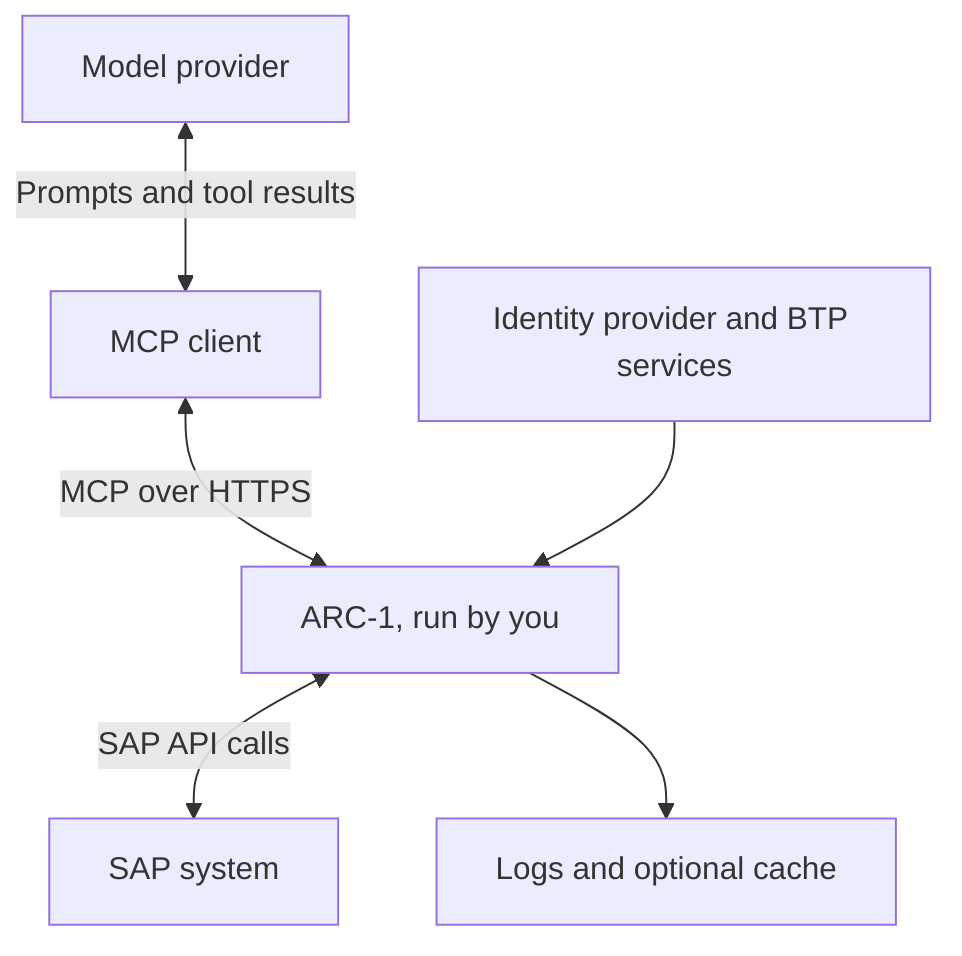

# Security Review

Use this page to decide whether your organization can approve ARC-1. It answers the questions
security reviewers, SAP owners and BTP administrators usually ask. Each answer ends with what your
team has to decide, and the page ends with a decision record you can copy into your ticket.

Approve one concrete setup: a version or commit, its configuration, and the MCP client and model
provider that connect to it. This site follows `main`, so read the docs from the tag you deploy.

## Where your data goes



This shows a shared HTTP deployment. Local stdio runs as a process on the user's machine and has no
MCP authentication.

## Questions and answers

### Can SAP data leave our environment?

Yes. ARC-1 returns tool results to the MCP client, and the client can send them to its model
provider. Results can include source code, metadata, error details and, if you enable it, table
data. Running ARC-1 on your own BTP account does not change this, and ARC-1 cannot control what the
client does next. The [MCP specification](https://modelcontextprotocol.io/specification/2025-11-25#security-and-trust-safety)
leaves user consent to the client application.

**Decide (AI or platform team):** which client and model provider you approve, and whether their
retention, training and region terms fit that data.

### Whose SAP permissions apply?

With [Principal Propagation](principal-propagation-setup.md), each user works in SAP as their own
SAP user. Signing in to ARC-1 does not do this by itself. With a shared technical user, everyone
gets that user's permissions and SAP sees only that one user.

**Decide (SAP Basis and security):** use Principal Propagation if you need individual identities,
and test it with two users who have different SAP roles.

### What can the AI read or change?

Writes, table preview, free SQL, transport changes and Git changes are all off by default. An
administrator enables each one separately, and SAP authorization still applies. Three limits remain:

- The package allowlist restricts writes, not reads.
- Read-only access still exposes source code and metadata, and checks such as ATC create load on SAP.
- SAP content can contain prompt injection. These limits decide what is allowed, not whether an
  allowed request is what the user meant.

**Decide (SAP owner):** which capabilities each use case needs. See
[Authorization & Roles](authorization.md) and the [Hardening Guide](security-guide.md).

### What is logged or stored?

ARC-1 writes audit events to stderr, a file or the BTP Audit Log. Redaction removes sensitive
values, but logs still show users, tools and errors. The default cache stays in memory. If you
select `ARC1_CACHE=sqlite`, source code is stored on disk unencrypted.

**Decide (operations and data owners):** who can read the logs, how long they are kept, and which
cache mode you allow. See [audit logging](security-guide.md#9-audit-logging) and
[cache security](caching.md#security).

### How are dependencies checked?

The project uses Dependabot, `npm audit`, Dependency Review, CodeQL and Trivy. They report problems,
but none of them is required for merging. What you can verify also differs by artifact: the
published npm SBOM, for example, does not describe a BTP build or the optional AppRouter.

**Decide (build or BTP owner):** approve an exact commit or image digest, keep the
[evidence for that artifact](security-guide.md#13-dependency-supply-chain-security), and recheck it
when new advisories appear.

### Who fixes vulnerabilities, and which version should we approve?

The maintainer takes [private reports](https://github.com/arc-mcp/arc-1/security/advisories/new) and
publishes [advisories](https://github.com/arc-mcp/arc-1/security/advisories) and fixes. Only the
latest 1.x minor line gets fixes. Response targets are
[best effort](https://github.com/arc-mcp/arc-1/blob/main/SECURITY.md), and there is no support contract.

Check the advisories before you approve a version. For example,
[GHSA-6935-r3wv-f646](https://github.com/arc-mcp/arc-1/security/advisories/GHSA-6935-r3wv-f646)
(high) let a client gain access without the user's approval on XSUAA deployments up to 1.7.0. It
is fixed in 1.8.0, and 1.9.0 or later is recommended. On BTP the upgrade also needs an
[XSUAA callback update](xsuaa-setup.md#upgrading-an-existing-deployment), and it does not revoke
tokens that were already issued.

**Decide (deployment owner):** who watches advisories, who deploys updates, and who responds to
incidents. See [Updating](updating.md) and [BTP Administration](btp-administration.md).

### What independent assurance exists?

There is no independent audit, ISO 27001 certificate, SOC 2 report or SAP certification. The project
publishes its [threat model](https://github.com/arc-mcp/arc-1/blob/main/docs/security-model.md) and
[security review record](https://github.com/arc-mcp/arc-1/blob/main/docs/security-review-2026-06.md).
Both are maintainer-led and AI-assisted.

**Decide (security team):** whether that meets your approval requirements.

## Recommended first deployment

1. Start in a development SAP system, with an approved client and model.
2. Deploy an approved commit or image digest, and keep its
   [evidence](security-guide.md#13-dependency-supply-chain-security).
3. Use per-user identity and least-privilege SAP roles. For production Principal Propagation, set
   `SAP_PP_STRICT=true` explicitly. See [BTP deployment options](btp-overview.md).
4. Leave writes, table preview, free SQL, transport writes and Git writes off until a use case needs
   them. Leave extensions and the web UI off too.
5. Test that a denied action is refused, that audit events name the real user, and that you can
   update and roll back.

## Record your decision

Copy this into your own ticket. Tick an item only after checking your actual deployment, and revisit
the record when the version, permissions, client or model provider changes.

```text
ARC-1 security review

Review date and reviewer:
Approved ARC-1 version and source commit or image digest:
BTP environment and SAP system/client:
Approved MCP client and model provider:
Deployment/update owner:
Incident contact:

[ ] Client, model provider and permitted data approved
[ ] SAP identity and permissions tested
[ ] Enabled and disabled capabilities recorded
[ ] Advisories checked for this version
[ ] Dependency, build and staging evidence reviewed
[ ] Log access, retention and cache settings agreed
[ ] Updates, advisory monitoring and incident response assigned

Decision: approved / approved with conditions / open
Conditions or open questions:
Next review date:
```
